<div align="center">

# In to the Repo

Understand any GitHub repository in minutes, not weeks.

<br/>

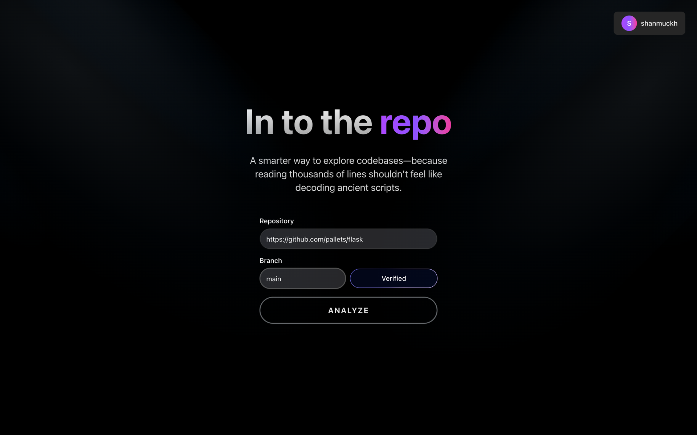

<br/>

</div>

Paste a repo URL. In to the Repo clones it, parses every file into a syntax tree,
maps how the code fits together, digs through its git history, and gives you an
AI guide that explains any file line by line.

---

## Why In to the Repo?

Joining a new codebase usually means days of clicking through folders, guessing which
files matter, and reading code without context. In to the Repo turns that into a guided tour:

- **See the whole system at once.** An interactive architecture map shows which modules depend on which.
- **Know where to look first.** Git history shows the files that change most and the people who change them.
- **Understand any file quickly.** The AI writes a plain-English summary and a step-by-step tutorial tied to the actual line numbers.
- **Ask questions.** A built-in assistant answers questions about the code you're reading.

It's built for engineers onboarding onto a new team, open-source contributors sizing up
a project, reviewers, students learning from real-world code, and tech leads auditing
an unfamiliar service.

---

## Feature tour

### 1. Analyze any public repository
Enter a GitHub URL and branch. In to the Repo checks that the repository and branch exist,
then queues the analysis in the background and shows live progress while it works.

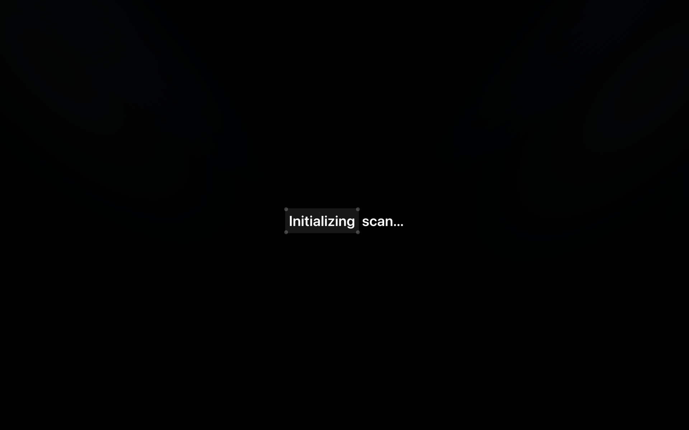

### 2. Your repository dashboard
Every view is one click away from the floating dock: the architecture map, git analysis,
file analysis, file graph, call graph, tutorial and assistant.

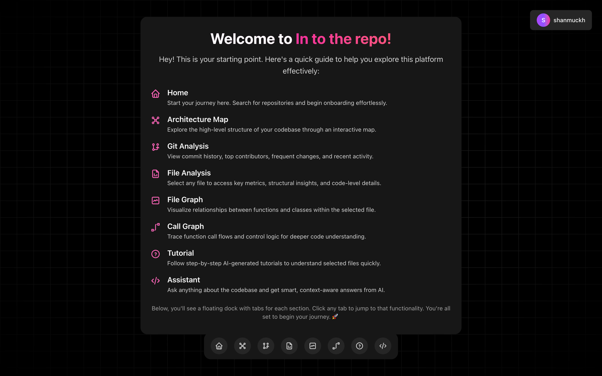

### 3. Architecture map
An interactive, zoomable graph of how every file imports every other file. It resolves
relative imports, packages (`__init__.py`, `index.ts`) and `src/`-layout projects, so the
connections reflect the real structure. Click a node for its details.

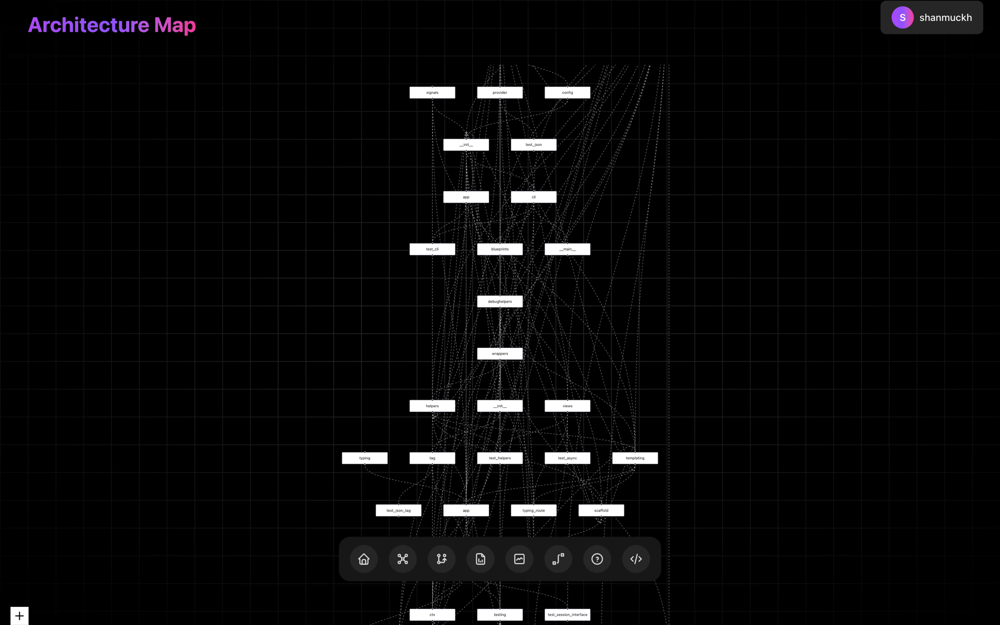

### 4. Git analysis
Contributors, the most frequently changed files (the usual hot spots), and a readable
timeline of recent commits, read from the real commit history.

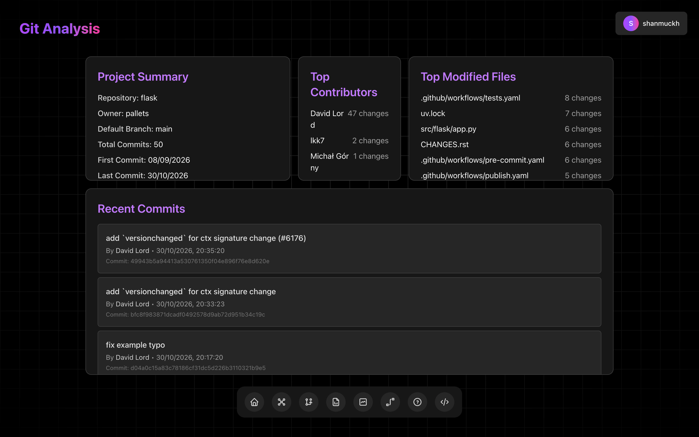

### 5. AI file analysis
Pick any file to get an AI-written summary of what it does and why it exists, next to
the source code.

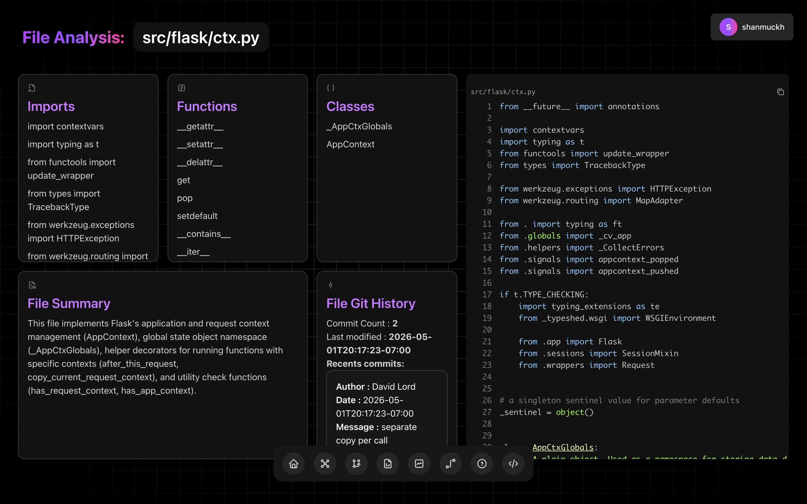

### 6. Step-by-step tutorials
The AI walks through the file in order, and each step links to the exact lines it explains.

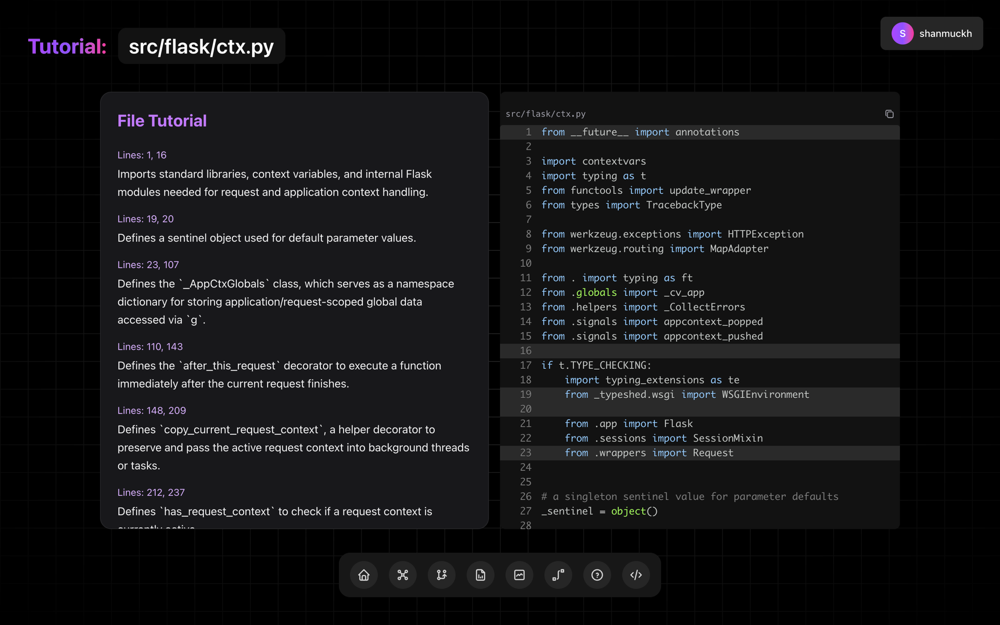

### 7. File graph and call graph
See a file's classes and functions, then follow who calls what inside it.

<p>
  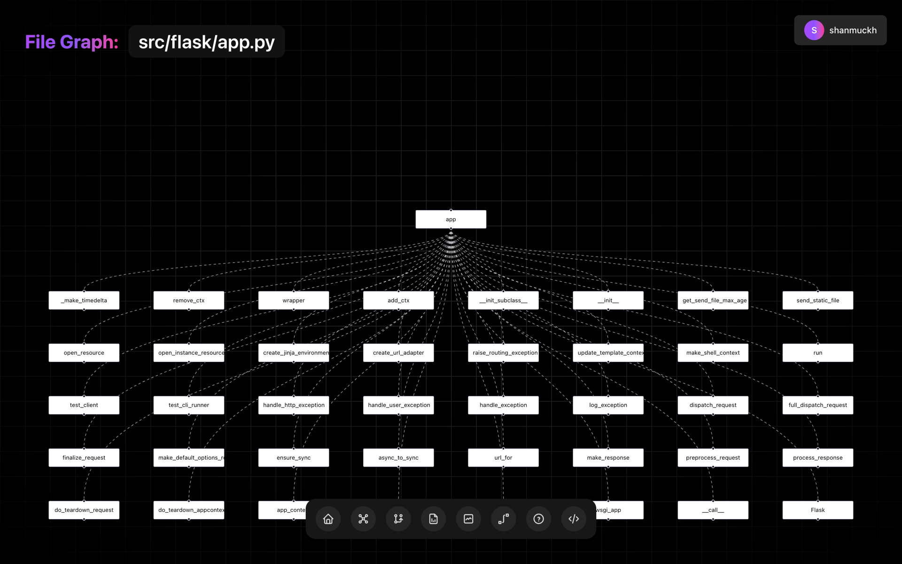
  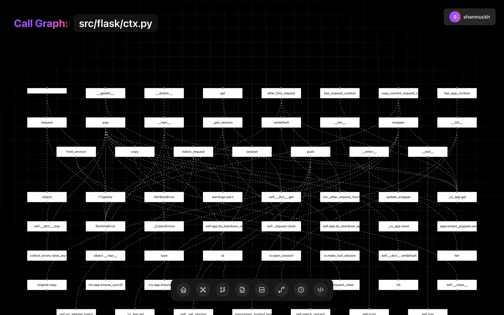
</p>

### 8. AI code assistant
Ask anything about the file you're looking at. The conversation keeps its context, so
you can ask follow-up questions.

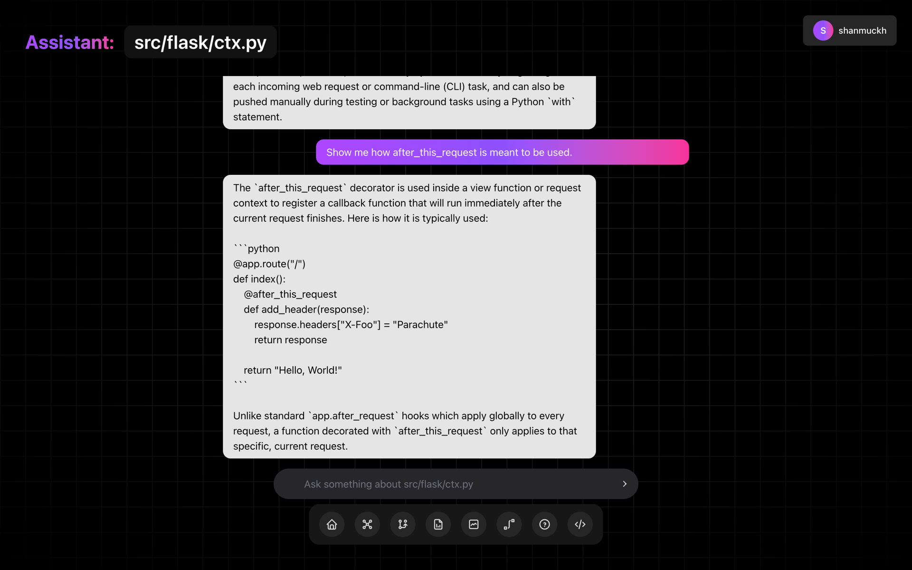

### 9. Accounts and history
Sign in to keep a history of every repository you've analyzed and reopen any of them instantly.

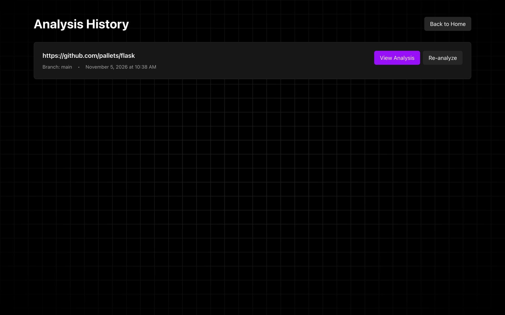

---

## Built for speed

| | |
|---|---|
| **Commit-aware caching** | Results are stored per commit. Analyzing the same commit again returns instantly, and new commits trigger a fresh analysis automatically. |
| **Single-pass git history** | One `git log` pass replaces thousands of per-file git calls. It parses about 1,200 files in roughly a second. |
| **Blobless clones** | Fetches 50 commits of history without downloading old file contents. |
| **Background workers** | Celery runs analyses outside the API, so it stays responsive while you watch progress live. |
| **Lean storage** | Large results live in PostgreSQL, and Redis only holds what's needed to report progress. |

---

## How it works

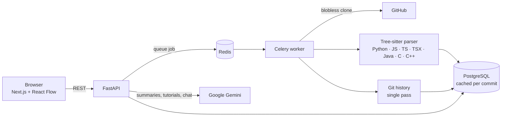

1. **Verify:** confirms the repository is public and the branch exists.
2. **Queue:** the API hands the job to a Celery worker and returns a task ID immediately.
3. **Clone:** a blobless, history-aware clone (skipped entirely if this commit is already cached).
4. **Parse:** Tree-sitter extracts imports, classes, functions, calls and complexity from every source file.
5. **Map:** imports are resolved into a dependency graph, and git history becomes per-file stats.
6. **Explain:** Gemini generates summaries, tutorials and chat answers when you open a file.

---

## Tech stack

| Layer | Technology |
|---|---|
| Frontend | Next.js 16 (App Router), React 19, TypeScript, Tailwind CSS 4, React Flow + Dagre, Motion |
| API | FastAPI, Pydantic, SlowAPI rate limiting, JWT auth with bcrypt |
| Workers | Celery with a Redis broker |
| Code intelligence | Tree-sitter grammars for Python, JavaScript, TypeScript, TSX, Java, C and C++ |
| Data | PostgreSQL (SQLAlchemy), Redis |
| AI | Google Gemini via `google-genai` |
| Deployment | Docker Compose, Caddy (automatic HTTPS) |

---

## Run it locally

**Prerequisites:** macOS or Linux, Node.js 18+, Python 3.12, PostgreSQL 16, Redis 7, Git,
and a [Gemini API key](https://aistudio.google.com/apikey) (the AI features need one;
everything else works without it).

```bash
git clone https://github.com/shanmuckh/in-to-the-repo.git
cd in-to-the-repo
```

```bash
brew install postgresql@16 redis   # macOS; use your package manager on Linux
make services                      # start PostgreSQL + Redis
```

Create the database (one time only):

```bash
createuser repo_user -P            # password: repo_password
createdb -O repo_user in_to_the_repo
```

```bash
make setup                         # Python venv, dependencies, backend/.env
```

Add your key to `backend/.env`:

```
GEMINI_API_KEY=your-key-here
```

```bash
make dev                           # API :8000, Celery worker, frontend :3000
```

Open **http://localhost:3000**, sign up, and analyze a repository. Some good ones to try:
`https://github.com/pallets/flask` (`main`) and `https://github.com/pallets/click` (`main`).

### Useful commands

| Command | What it does |
|---|---|
| `make dev` | Start the API, the worker and the frontend together |
| `make test` | Run the backend test suite |
| `make health` | Check that the API, frontend, Redis and Postgres are up |
| `make up` / `make down` | Start or stop everything with Docker Compose |

### Configuration (`backend/.env`)

| Variable | Required | Purpose |
|---|---|---|
| `DATABASE_URL` | yes | PostgreSQL connection string |
| `REDIS_URL` | yes | Redis broker and progress store |
| `SECRET_KEY` | yes | Signs login tokens (`make setup` generates one) |
| `GEMINI_API_KEY` | for AI | Enables summaries, tutorials and the assistant |
| `GEMINI_MODEL` | no | Main Gemini model (default `gemini-flash-latest`) |
| `GEMINI_FALLBACK_MODEL` | no | Used automatically when the main model is overloaded (default `gemini-flash-lite-latest`) |
| `GITHUB_TOKEN` | no | Raises GitHub API rate limits |
| `GIT_HISTORY_DEPTH` | no | Number of commits to analyze (default `50`) |
| `FRONTEND_HOST` | no | Extra origin allowed by CORS |

---

## Project structure

```
in-to-the-repo/
├── backend/
│   ├── src/
│   │   ├── api/            # REST routes: analysis, auth, history, assistant
│   │   ├── services/
│   │   │   ├── analysis/   # Tree-sitter parsing, import resolution, graphs
│   │   │   ├── ai/         # Gemini summaries, tutorials, chat
│   │   │   └── utilities/  # git history, cloning, caching
│   │   ├── tasks/          # Celery worker
│   │   ├── models/         # SQLAlchemy models
│   │   └── main.py
│   └── tests/
├── frontend/
│   └── src/
│       ├── app/            # pages: home, analyze/*, history, auth
│       └── components/     # graphs, file analysis, tutorial, assistant
├── docs/screenshots/
├── docker-compose.dev.yml
└── Makefile
```

---

## Where it's headed

In to the Repo already gives you a full picture of a codebase. Here's what comes next:

- **Semantic code search:** ask "where do we validate tokens?" across the whole repo (the embeddings groundwork is already in place).
- **Private repositories** through GitHub OAuth.
- **More languages:** Go, Rust, Ruby, C# and Kotlin through additional Tree-sitter grammars.
- **Onboarding paths:** an auto-generated "read these 10 files first" guide for new team members.
- **PR impact analysis:** see which modules a pull request touches before you review it.
- **Team workspaces:** share analyses, notes and guided tours across a team.
- **A VS Code extension** that brings the maps and explanations into your editor.

Interested in any of these, or in using In to the Repo at your company? See [Licensing](#license).

---

## Contributing

Bug reports, ideas and pull requests are welcome. Please read the
[Code of Conduct](CODE_OF_CONDUCT.md) first. By contributing, you agree that your
contribution may be used as part of this project under its [license](LICENSE).

---

## Support the project

If In to the Repo saves you time, please consider sponsoring its development. It funds
the hosting and AI costs and keeps new features coming.

**[Become a sponsor →](https://github.com/sponsors/shanmuckh)**

---

## License

**Copyright © 2026 Surakarapu Shanmukh Srinivas. All rights reserved.**

In to the Repo is **source-available, not open source**. You may view the code and run it
for personal, non-commercial learning and evaluation. **Any commercial use, redistribution,
or derivative work requires prior written permission from the owner.** See [LICENSE](LICENSE)
for the full terms, and reach out through [GitHub](https://github.com/shanmuckh) to ask about permissions.

<div align="center">
<br/>

Built by **Surakarapu Shanmukh Srinivas** · [@shanmuckh](https://github.com/shanmuckh)

</div>
